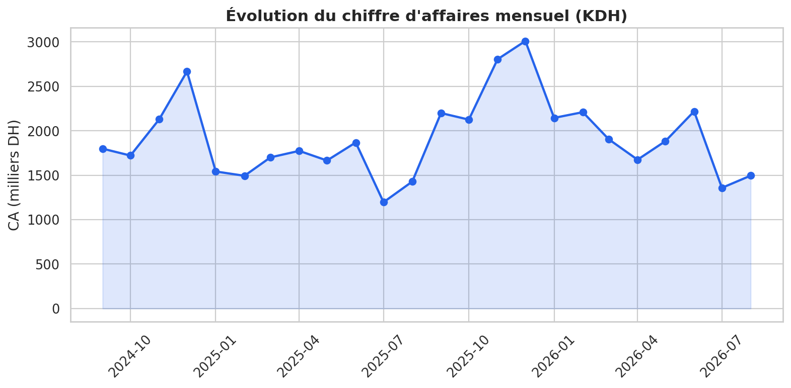
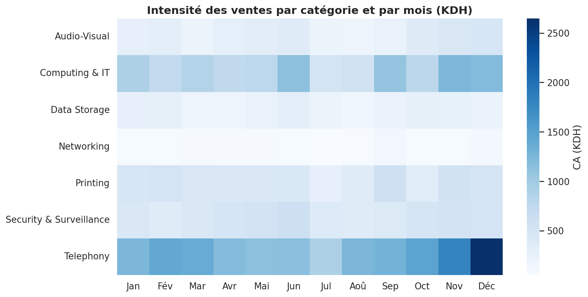
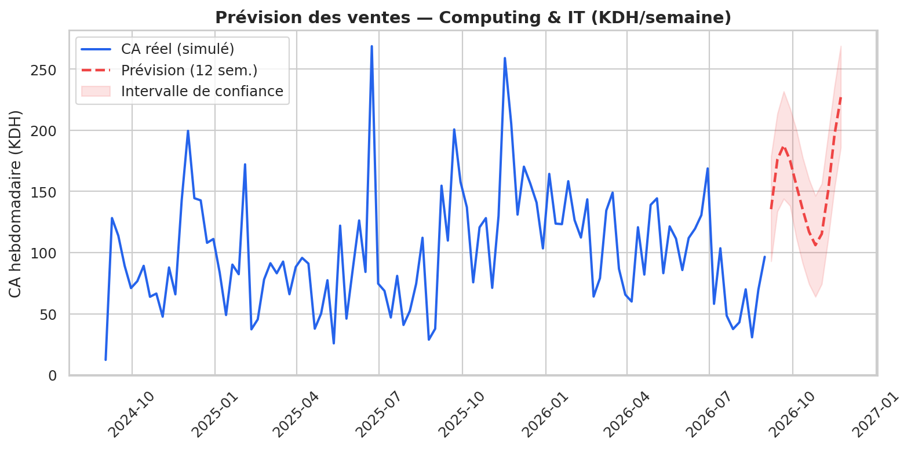
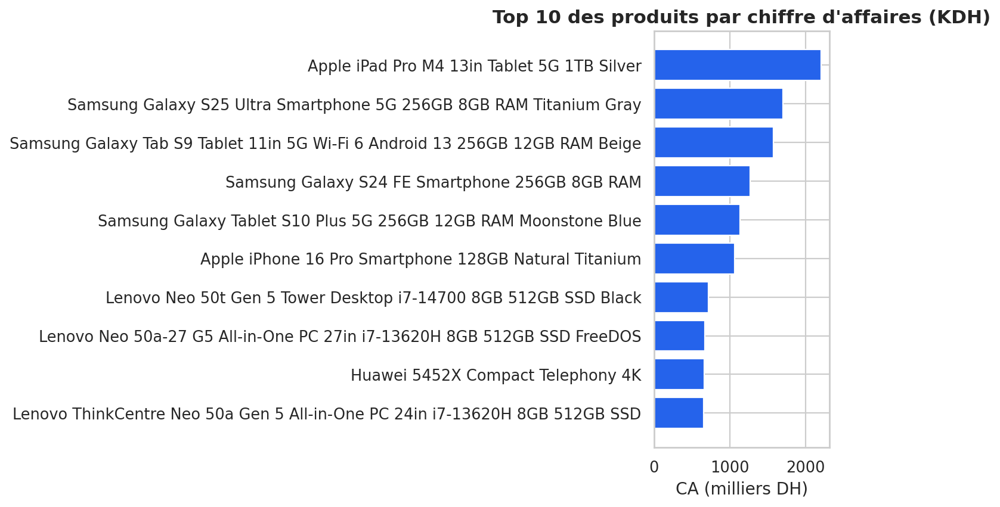

# 📈 Sales Forecasting & BI Dashboard — Prophet · Streamlit

   

**EN —** End-to-end data project built during my Data/BI internship at **KARAMCASA** (IT & security equipment distributor, Casablanca): product catalogue built from scraped real data, realistic simulated 24-month sales history, cleaning & KPI pipeline, exploratory analysis, **Prophet** forecasting per product category, and an interactive **Streamlit/Plotly** dashboard.

**Auteur :** Ali Elfanity — stage Data/BI (juillet–août 2026) · EMSI Casablanca · [LinkedIn](https://www.linkedin.com/in/ali-elfanity)

## Résultats clés

| Élément | Valeur |
|---|---|
| Catalogue | 397 références sur 7 catégories, dont ~140 produits réels collectés sur le site de l'entreprise |
| Historique | 11 422 lignes de vente simulées (sept. 2024 → août 2026), 0 doublon / 0 valeur manquante après contrôle |
| Modèle | 1 modèle Prophet par catégorie, CA hebdomadaire, test sur les 8 dernières semaines |
| Précision | **MAPE mensuel de 19 % à 48 %** selon la catégorie (≈ 29 % en moyenne) — Telephony 18,6 %, Printing 21,3 %, Security 22,6 % |
| Livrable | Dashboard Streamlit : KPIs, CA par catégorie / ville / produit, saisonnalité, prévisions |

> ⚠️ **Méthodologie :** l'entreprise ne disposant pas d'export de ventes exploitable pendant le stage, l'historique de ventes est **simulé** (saisonnalité rentrée, Black Friday, fin d'année, creux estival). Le projet démontre la chaîne complète et la méthode, à réappliquer sur les données réelles.

## Aperçu

| CA mensuel global | Saisonnalité par catégorie |
|---|---|
|  |  |
| **Prévision Prophet — Computing & IT** | **Top 10 produits** |
|  |  |

## Contenu du projet

```
sales-forecasting-prophet-bi/
├── data/                     # Données (générées par les scripts)
│   ├── real_products_raw.csv     # Échantillon RÉEL scrapé sur karamcasa.ma (~140 produits)
│   ├── catalog.csv               # Catalogue complet (réel + extension statistique)
│   ├── sales.csv / sales_clean.csv
│   ├── agg_daily.csv / agg_monthly.csv
│   ├── kpis.json / quality_report.json
│   ├── forecast_history.csv / forecast_future.csv / forecast_metrics.json
├── scripts/
│   ├── 01_build_catalog.py       # Construction du catalogue produits
│   ├── 02_generate_sales.py      # Génération de l'historique de ventes simulé
│   ├── 03_clean_aggregate.py     # Nettoyage + agrégations + KPIs
│   ├── 04_eda.py                 # Analyse exploratoire (figures pour le rapport)
│   └── 05_forecast.py            # Modèle de prévision Prophet par catégorie
├── dashboard/
│   └── app.py                    # Dashboard interactif Streamlit
├── exports/figures/          # Graphiques PNG générés (pour le rapport / soutenance)
└── requirements.txt
```

## Installation (VS Code / terminal)

```bash
cd sales-forecasting-prophet-bi
python3 -m venv venv
source venv/bin/activate          # Windows : venv\Scripts\activate
pip install -r requirements.txt
```

## Reproduire le pipeline complet

```bash
python3 scripts/01_build_catalog.py
python3 scripts/02_generate_sales.py
python3 scripts/03_clean_aggregate.py
python3 scripts/04_eda.py
python3 scripts/05_forecast.py
```

## Lancer le dashboard

```bash
cd dashboard
streamlit run app.py
```

Le dashboard s'ouvre automatiquement dans le navigateur (http://localhost:8501).

## Méthodologie & limites

- Le **catalogue produits** contient une partie réelle (~140 références collectées directement
  sur karamcasa.ma : noms, prix, catégories) et une partie synthétique générée statistiquement
  à partir des distributions réelles observées par catégorie, afin d'obtenir un catalogue
  représentatif des ~7 grandes familles de produits de l'entreprise (Computing & IT, Security &
  Surveillance, Printing, Networking, Data Storage, Audio-Visual, Telephony).
- L'**historique de ventes** est intégralement **simulé** (l'entreprise ne disposant pas d'un
  export de données de ventes exploitable au moment du stage), mais construit pour être réaliste :
  saisonnalité (rentrée scolaire, Black Friday, fêtes de fin d'année, creux estival), tendance de
  croissance, pondération par catégorie cohérente avec la taille réelle des catégories sur le site.
- Les résultats (dashboard, prévisions) démontrent la
  **faisabilité et la pertinence de l'approche**, à réappliquer sur les données réelles de
  l'entreprise dès qu'elles seront disponibles.

## Modèle de prévision

Un modèle **Prophet** est entraîné par catégorie sur le CA hebdomadaire. Les métriques
(MAE, RMSE, MAPE hebdomadaire et mensuel) sont calculées sur un jeu de test (8 dernières
semaines) et sauvegardées dans `data/forecast_metrics.json`. Le MAPE mensuel (18 à 48 % selon
les catégories) est plus stable que le MAPE hebdomadaire et est recommandé pour la planification
des achats.
